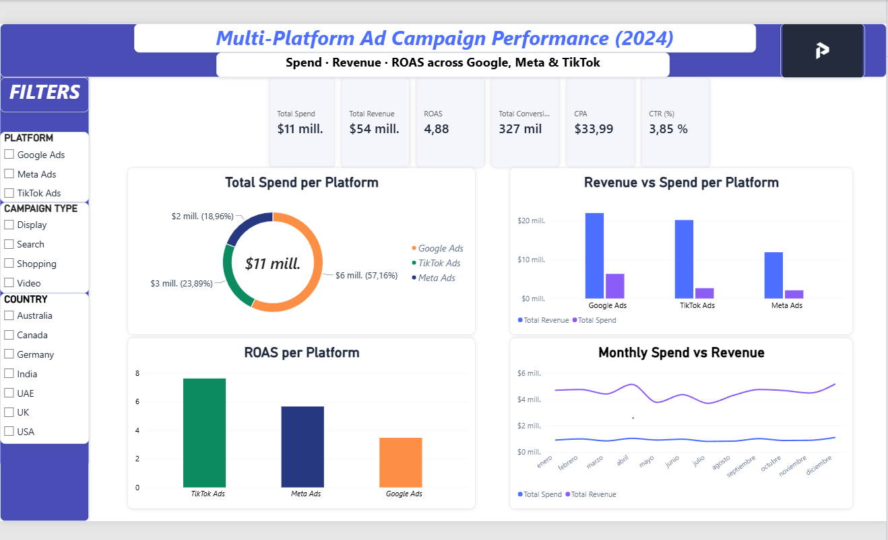
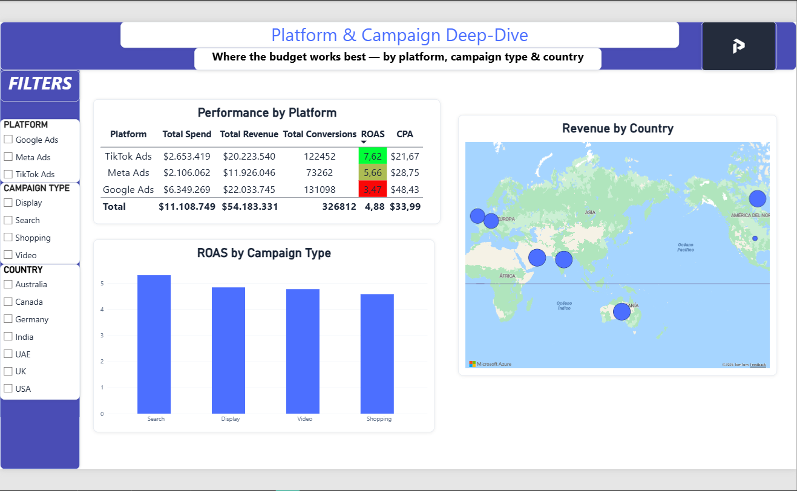
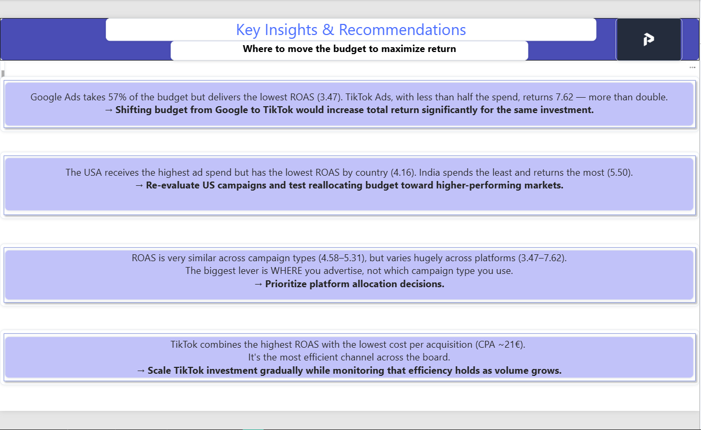

# 📊 Multi-Platform Ad Campaign Performance Analysis

**End-to-end marketing analytics project** analyzing ad campaign performance across **Google, Meta and TikTok** — from raw data cleaning in Excel to an interactive Power BI dashboard with business recommendations.

---

## 🎯 The Business Question

**Where is the ad budget working best, and where is money being wasted?**

Companies spend heavily across ad platforms without always knowing which ones truly deliver return. This project analyzes 1,800 campaigns to find out.

---

## 🛠️ Tools & Skills

| Stage | Tools |
|-------|-------|
| **Data cleaning & exploration** | Excel (pivot tables, formulas, conditional formatting) |
| **Metrics & analysis** | ROAS, CPA, CPC, CTR calculations |
| **Modeling & measures** | Power BI, DAX |
| **Visualization** | Power BI (3-page interactive dashboard, map, slicers) |
| **Business** | KPI definition, insights, strategic recommendations |

---

## 🔍 Key Findings

- 💸 **Google Ads takes 57% of the budget but has the lowest ROAS (3.47)** — while **TikTok Ads returns 7.62** with less than half the spend.
- 🌍 **The USA receives the most spend but the lowest ROAS by country (4.16)**; India spends the least and returns the most (5.50).
- 🎯 **Platform matters more than campaign type** — ROAS varies hugely across platforms (3.47–7.62) but barely across campaign types (4.58–5.31).
- ✅ **TikTok is the most efficient channel** — highest ROAS and lowest cost per conversion.

---

## 💡 Recommendations

1. **Reallocate budget from Google to TikTok** to increase total return for the same investment.
2. **Re-evaluate US campaigns** and test shifting budget toward higher-performing markets.
3. **Prioritize platform allocation** decisions over campaign-type decisions.
4. **Scale TikTok investment gradually** while monitoring efficiency as volume grows.

---

## 📊 Dashboard

### Overview

### Platform & Campaign Deep-Dive

### Key Insights & Recommendations

---

## 📥 Explore the Dashboard

**[⬇️ Download the interactive Power BI dashboard (.pbix)](https://drive.google.com/file/d/1hAf3z__yIq76qMWP9Q8NaKjSvvXBDE9_/view?usp=drive_link)**

*Requires [Power BI Desktop](https://powerbi.microsoft.com/desktop/) (free). The Excel analysis file is also included in this repo.*

---

## 📁 Data

Dataset: Global Ads Performance (Google, Meta, TikTok) — public dataset from Kaggle. 1,800 campaign records across platforms, campaign types, industries and countries.

---

**Author:** Álex Paniagua López — *Panix Analytics*
📊 Marketing & Data Analyst | 🔗 [LinkedIn](https://www.linkedin.com/in/alex-paniagua-data)
